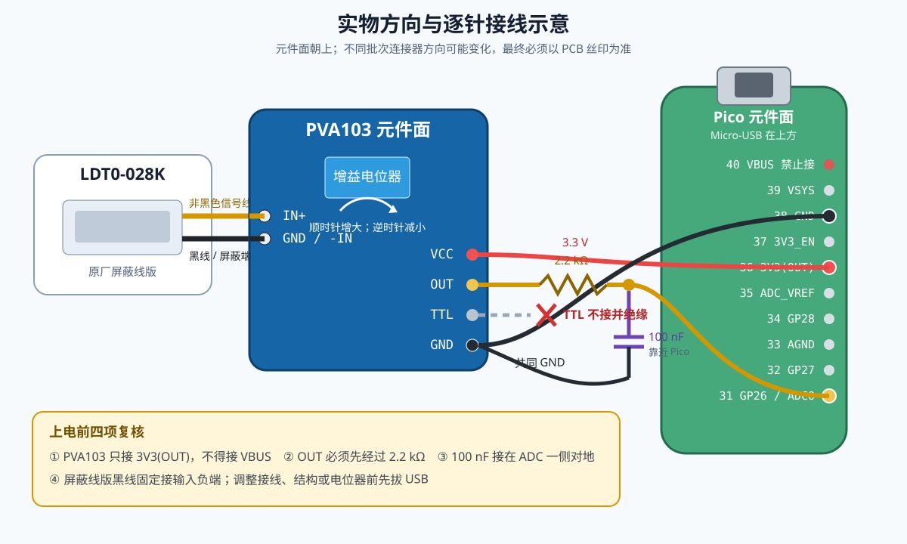

# BOM 与逐针接线

## 1. 必需物料

| 类别 | 名称与规格 | 数量 | 选型说明 |
| --- | --- | ---: | --- |
| 传感器 | LDT0-028K PVDF 压电膜，优先选原厂屏蔽线版 | 1 | 使用原厂压接端子，不在膜片电极上直接焊接；屏蔽线版的黑线/屏蔽端固定接输入负端。 |
| 模拟前端 | PVA103 电荷放大模块 | 1 | 供电范围 2.8–9 V，具有模拟 `OUT` 和比较器 `TTL`；本项目只用 `OUT`。 |
| 控制器 | Raspberry Pi Pico，RP2040，已焊排针 | 1 | 使用 GP26/ADC0 和原生 USB CDC。Pico W 也可用，但本教具不使用 Wi-Fi。 |
| 电阻 | 2.2 kΩ，1%，1/4 W | 1 | 串在 PVA103 `OUT` 与 Pico ADC 之间。 |
| 电容 | 100 nF，X7R 或 C0G，额定电压不低于 10 V | 1 | 接在 ADC 侧与 GND 之间，与 2.2 kΩ 构成约 723 Hz 的一阶低通。 |
| 连接 | 面包板和公母杜邦线 | 1 套 | 原型阶段使用；长期课堂使用建议焊到洞洞板并加热缩管。 |
| USB | Micro-USB 数据线 | 1 | 必须是可传数据的线，不能使用只有供电芯的充电线。 |
| 电脑 | Windows 10/11 电脑 | 1 | 运行中文上位机和机器人模拟器。 |

### 1.1 下单时避免买错型号

用户提供的商品页把 `LDTM-028K 带质量块屏蔽线 + 模块`标成“推荐”，但本教具明确使用 `LDT0-028K 无质量块屏蔽线版`。型号中的 `M` 表示额外质量块，主要用于振动/加速度响应，会改变谐振频率、灵敏度和机械安装方式；不能把 LDTM 当作本方案的等价替代品。下单前应让卖家确认包装标签为 `LDT0-028K`，并确认包含屏蔽线和与 PVA103 匹配的插头。

## 2. 机械与保护物料

| 名称 | 建议规格 | 数量 | 用途 |
| --- | --- | ---: | --- |
| 底板 | 约 180 mm × 100 mm 的亚克力、木板或 3D 打印板 | 1 | 固定 Pico、PVA103 和触摸区。 |
| 尼龙隔离柱 | M2/M2.5/M3，按模块孔径选择 | 4–8 | 防止模块背面短路。 |
| 薄 PET 片 | 0.2–0.5 mm | 1 | 制作可弯曲触摸舌片，可选。 |
| 硬限位垫块 | 1–2 mm 高的尼龙垫片、亚克力条或 3D 打印件 | 2 | 从两侧限定舌片最大行程；不能让硬边直接顶住 PVDF 活动区。 |
| 薄缓冲垫 | 0.3–0.5 mm 硅胶或软泡棉 | 少量 | 覆盖在硬限位的宽平接触面上，只负责缓冲撞击，不负责决定行程。 |
| Kapton 胶带 | 10–15 mm 宽 | 少量 | 固定非敏感端、绝缘和应力释放。 |
| 扎带/热缩管 | 小号 | 少量 | 固定导线，防止拉力直接作用在传感器压接处。 |

## 3. 调试与可选物料

- 万用表：首次上电测量 3.3 V、GND 和静态 OUT。
- 小型示波器：不是必需，但便于观察前端削顶和 50 Hz 干扰。
- 铜箔或导电布：长传感器线无法缩短时用于屏蔽，只允许单端接 PVA103 GND。
- 参考动态测力计或带同步采样的称重传感器：仅在需要输出“估算动态力 N”时使用。

普通砝码不适合直接标定 PVDF。砝码放稳后是静态载荷，而 LDT0-028K 的输出会衰减回基线。

## 4. 端子识别

### 4.1 PVA103 四针输出端

以模块元件面朝上、四针端子位于右侧时，厂商资料所示从上到下为：

1. `VCC`：模块电源，接 3.3 V；
2. `OUT`：模拟信号输出；
3. `TTL`：比较器数字输出，本项目不接；
4. `GND`：电源地和输出地。

不同批次可能更换连接器方向。实际接线必须以 PCB 丝印 `VCC/OUT/TTL/GND` 为准，不能只根据“最上面一针”判断。



图中按厂商手册的元件面方向绘制，用于辨认连接关系而非机械尺寸。Pico 仍须同时核对板上丝印和物理针号。

### 4.2 PVA103 两针传感器端

- `IN+`：接 PVDF 信号正端；
- `GND` / `-IN`：接 PVDF 信号负端。

原厂屏蔽线版有明确极性：黑线与屏蔽层相连，是负端，必须接 PVA103 的输入 `GND` / `-IN`；另一根信号线接 `IN+`。只有完全无屏蔽、两个电极都悬浮的裸两线版本才可以互换，互换会改变波形首峰极性。课堂装配后应固定方向，不能把“裸片可互换”误用于屏蔽线版。

### 4.3 Raspberry Pi Pico 使用的针脚

| Pico 功能 | 板上标识 | 物理针脚 | 连接对象 |
| --- | --- | ---: | --- |
| ADC 输入 | `GP26/ADC0` | 31 | 接 2.2 kΩ 的 ADC 侧和 100 nF 电容。 |
| 3.3 V 输出 | `3V3(OUT)` | 36 | 接 PVA103 `VCC`。 |
| 地 | `GND` | 38 | 接 PVA103 `GND` 和 100 nF 电容另一端，保持模块供电与滤波回流共点。 |

不要使用物理 40 脚 `VBUS` 给 PVA103 供电。PVA103 用 5 V 供电时，OUT 的正向摆幅可能超过 Pico ADC 的 3.3 V 绝对上限。

把 Pico 的 Micro-USB 接口朝上、元件面朝向自己时，右侧排针靠近 USB 的一段如下。必须同时核对板上丝印，不要只按示意图数针：

```text
Micro-USB 在上方

右侧排针，由上向下：
物理 40  VBUS       禁止接 PVA103
物理 39  VSYS       本项目不接
物理 38  GND        → PVA103 GND、100 nF
物理 37  3V3_EN     本项目不接
物理 36  3V3(OUT)   → PVA103 VCC
物理 35  ADC_VREF   本项目不接
物理 34  GP28       本项目不接
物理 33  AGND       默认不接；只用于降噪 A/B 试验
物理 32  GP27       本项目不接
物理 31  GP26/ADC0  ← 2.2 kΩ 与 100 nF 的连接点
```

厂商资料给出的 PVA103 供电范围是 2.8–9 V，并推荐在一般场景使用 5 V。本教具有意改用 3.3 V：这样 PVA103 和 Pico ADC 处于同一电压域，无需再增加分压、钳位或电平转换，课堂接线更简单且更不容易损坏 ADC。代价是前端可用摆幅变小，因此必须通过电位器调整增益并保留削顶余量。

## 5. 逐针接线表

所有接线必须在 USB 断开的情况下完成。

| 序号 | 起点 | 中间器件 | 终点 | 作用 |
| ---: | --- | --- | --- | --- |
| 1 | LDT0-028K 屏蔽线版的非黑色信号线 | 原厂插头 | PVA103 `IN+` | 把传感器正端电荷信号送入放大器。 |
| 2 | LDT0-028K 黑线/屏蔽端 | 原厂插头 | PVA103 传感器端 `GND` / `-IN` | 按厂商定义固定为负端；不得与正端互换。 |
| 3 | Pico 物理 36 脚 `3V3(OUT)` | 直连 | PVA103 `VCC` | 让前端在 ADC 安全电压域内工作。 |
| 4 | Pico 物理 38 脚 `GND` | 直连 | PVA103 `GND` | 建立共同电位参考，并避免模块供电回流直接进入 AGND。 |
| 5 | PVA103 `OUT` | 串联 2.2 kΩ | Pico 物理 31 脚 `GP26/ADC0` | 限制瞬态电流并与电容构成低通。 |
| 6 | Pico 物理 31 脚 `GP26/ADC0` | 100 nF | Pico 物理 38 脚 `GND` | 衰减高频噪声；电容应靠近 Pico。 |
| 7 | PVA103 `TTL` | 不连接并单独绝缘 | 无 | 避免把比较器输出误接到 ADC。 |

## 6. 文字接线图

```text
LDT0-028K 非黑色信号线 ─────── PVA103 IN+
LDT0-028K 黑线/屏蔽端 ───────── PVA103 输入 GND / -IN

Pico 物理 36 / 3V3(OUT) ───── PVA103 VCC
Pico 物理 38 / GND ────────── PVA103 GND

PVA103 OUT ──[ 2.2 kΩ ]──●── Pico 物理 31 / GP26 / ADC0
                         │
                      [100 nF]
                         │
Pico 物理 38 / GND ─────●

PVA103 TTL ── 不接；端头单独绝缘
Pico 物理 40 / VBUS ── 禁止接入本电路
```

2.2 kΩ 和 100 nF 的截止频率约为：

`fc = 1 / (2πRC) ≈ 723 Hz`

该网络能在 2 kS/s 采样前衰减部分高频噪声，同时保留触摸、敲击和弯曲的主要动态成分。它不是高阶抗混叠滤波器，因此传感器线仍需远离开关电源和市电线。

## 7. 首次上电检查

### 7.1 断电检查

1. 确认 PVA103 的 `VCC` 只接 Pico `3V3(OUT)`，没有接 `VBUS` 或 `VSYS`。
2. 确认 PVA103 `OUT` 经过 2.2 kΩ 后才进入 GP26。
3. 确认 100 nF 接在 GP26 一侧与物理 38 脚 `GND` 之间，不要串联在信号线上。
4. 确认 `TTL` 悬空且端头不会碰到其他针脚。
5. 确认 Pico、PVA103 和传感器附近没有裸线碎屑。

### 7.2 通电检查

1. 先把 PVA103 增益电位器逆时针调到最低灵敏度附近。
2. 插入 USB，确认 Pico 和 PVA103 没有异常发热或气味。
3. 万用表测 PVA103 `VCC-GND`，应约为 3.3 V。
4. 万用表测 PVA103 `OUT-GND`，静置时应处于 0–3.3 V 之间且不贴近电源轨。
5. 打开上位机，确认收到 `HELLO`，参数为 2 kS/s、20 点/批、12 位 ADC、3,300 mV 参考电压。
6. 轻触传感器自由端，实时曲线应出现双极性或带振铃的瞬态波形。

如果 OUT 长期为 0 V、3.3 V，或轻触完全没有变化，应立即拔掉 USB，重新检查传感器插头、共同地和电位器位置。

## 8. 抗干扰布线规则

- 裸两线版本从 LDT0-028K 到 PVA103 应优先控制在 10 cm 内；本项目采购的原厂屏蔽线版可保留出厂长度，不要为了缩短而剪坏屏蔽层或压接端。
- 原厂屏蔽线版按厂商定义由黑线/屏蔽端接 PVA103 输入负端。若另加外部金属屏蔽罩，外加屏蔽罩只在 PVA103 一端接 GND，另一端悬空，不能与原厂信号芯线混接。
- 不要让传感器线与 USB 线、显示器电源线或 220 V 插线板平行捆扎。
- 不要用手直接捏住传感器输入裸线做测试，人体会引入明显的 50 Hz 工频信号。
- 先改善布线和屏蔽，再调整软件阈值；用高阈值掩盖干扰会同时丢失轻触事件。

### 8.1 关于 Pico AGND 的取舍

Pico 物理 33 脚 `AGND` 是 GP26–GP29 的模拟参考地，但 PVA103 只有一个同时承担供电与信号参考的 GND。本教具默认把 PVA103 GND 和 100 nF 一起接物理 38 脚，使模块电源回流不直接进入 AGND，且逐针方案只有一个明确地节点。

若实测数字噪声仍明显，可以做一次受控 A/B 试验：断电后把“PVA103 GND 和 100 nF 下端”作为一组同时改接物理 33 脚 AGND，比较静置噪声后选择更好的方案。不能把 PVA103 GND 接 38、滤波电容接 33，也不能同时拉两根地线形成回路。

## 9. 资料依据

- PVA103 端子、屏蔽线极性、供电范围、增益方向和输出摆幅依据深圳微精艺电子《PVDF 放大模块套件使用说明 0.6》：<https://d.vkinging.com/%E6%94%BE%E5%A4%A7%E5%99%A8%E7%9B%B8%E5%85%B3%E8%B5%84%E6%96%99/PVA103_%E5%8E%8B%E7%94%B5%E5%A5%97%E4%BB%B6/PVDF%E6%B5%8B%E8%AF%95%E5%A5%97%E8%A3%85%E5%BA%94%E7%94%A8%E8%AF%B4%E6%98%8E0.6.pdf>。
- Pico 物理针脚应与 Raspberry Pi 官方数据手册/实物丝印复核：<https://datasheets.raspberrypi.com/pico/pico-datasheet.pdf>。
