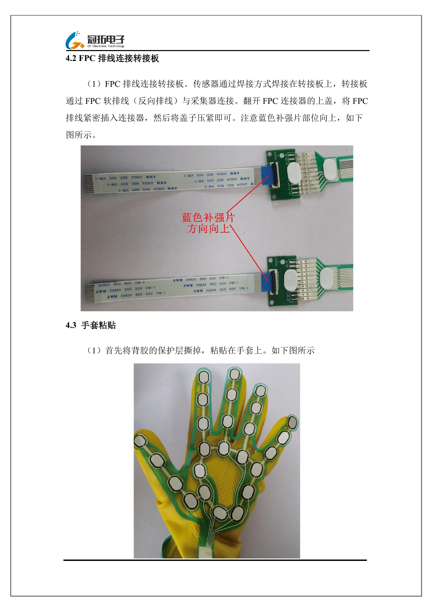
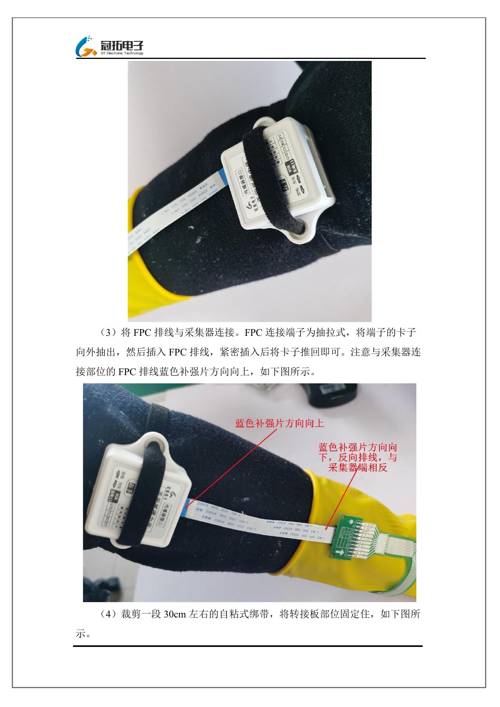

# GT-G0505M 厂家软件对照与安装核对

## 目前结论

电脑已经接收到采集器实时上报的右手数据，此前用户确认按压的原始记录中，25 路上报值一直为 0。随后用户在厂家软件按压对照中明确反馈“有帧率，但25点仍全为0”。两套软件表现一致，已基本排除自制界面独有的显示问题，排查重点应转向感应片、转接板、排线、采集器输入、按压方式及设备零点设置。还没有证据确定具体故障点，不能仅凭全零判定传感器损坏。

2026-10-16 复测：设备枚举为 **COMx**（此前曾为 COMx）。COMx 已不存在；在 COMx 上收到 262 个有效右手帧，校验错误 0，25 路峰值全为0。采集结束时出现一次串口拒绝访问，属于端口被其他程序重新占用或设备状态变化，前面的有效帧仍然可信。复测报告为 `current_trial_20261016_com4.json`。

同日最新复测：设备枚举为 **COMx**。10.032 秒收到 200 个有效右手帧，校验错误 0；其中 134 帧为非零，通道峰值出现约 273 g、44 g、937 g。说明本次按压已经进入采集器输出，传感器链路和协议均可工作。报告为 `current_trial_20261016_latest.json`，原始记录保存在 `release/G0505M实物接收检查_20261016_015614`。

2026-10-11 本轮检查结果：

- 下载的 14 个原始文件大小均与网盘清单一致。
- 新版中文版压缩包完整读取并通过 ZIP CRC 检查，已解压运行。
- 厂家进程的窗口标题为“G0505M 手掌压力采集上位机”，窗口响应正常。
- 厂家启动日志确认左手、右手图片均匹配 P01～P25；包内部分说明仍写 ES-48P 足底产品，不能据此使用 99 字节、48 点协议或鞋垫操作流程。
- 手掌专用协议说明与 PDF 第 17 页一致：53 字节、0x40 帧头、0x31/0x32 左右手、25 个大端 uint16、前 52 字节加和取低八位。
- 18:34:56 起被动接收 15.031 秒，收到 300 个有效右手帧，校验错误 0，25 路全过程峰值均为 0。本轮没有按压确认，按空载/操作未知记录处理。
- 此前 17:07:52 起记录 60.016 秒，用户在采集中回复“按了”；1201 个有效右手帧，25 路全过程峰值均为 0。
- 本轮另用标准库 `struct.unpack('>25H', ...)` 独立解码此前的 `valid_frames.bin`：1201 帧均为右手、校验正确、25 路最大值全零，结果不依赖教具的解析器。现有手掌协议测试全部通过。
- 随后用户完成厂家软件连接及按压对照，明确反馈“有帧率，但25点仍全为0”。这项数值结果来自用户观察；本次没有另行抓取厂家软件测试期间的原始串口流，具体帧率数值和按压位置尚未记录。
- 复查厂家日志，记录显示 20:48:03、20:48:12、20:48:36 打开 `COMx @ 115200`，读取的日志片段没有错误级别信息。日志不包含逐帧数值，不能独立证明本次厂家界面的25路全零；它支持串口打开情况。

本轮未发送型号、周期、左右手、比例、校准或清零设置指令。先前只读查询返回 5kg、50ms、右手、全局零值 20g、零点死区 3g、逐点零值禁用、比例 1.0000；这些是先前查询结果，本轮未重新查询。

## 直接使用厂家软件

新版中文版 EXE：

`<vendor-software-executable>`

资料根目录另有“打开厂家手掌采集软件.lnk”，指向上述 EXE，并把工作目录设为程序目录，方便保存厂家的数据库和日志。

1. 关闭或断开其他占用 COMx 的程序。
2. 在厂家软件的“实时监测”中选择 COMx，点击“连接”；串口参数为 115200、8N1。
3. 看右手数据和右手帧率。采集器上报的是右手，左手一直为零不代表故障。
4. 在安全支撑、平整贴合的条件下，按实际椭圆感应区域，分别保持几秒再松开，观察数字是否变化。
5. 首次对照不点击“零点标定”“清除零点”“设置量程”等写入设备的按钮。显示色标的变化也不能证明传感器输出变化。

新版包自带运行环境，解压后可直接启动。本次使用新版串口包，没有安装旧 V2.1 包携带的 NI/.NET 组件，也没有重装已经能正常通信的 CH340 驱动。

## 最需要检查的实物连接

### 手册要求反向排线，但文字与整机图的方向描述有差异

PDF 第 13 页 4.2 明确写“FPC 软排线（反向排线）”，并要求翻盖锁紧、蓝色补强片向上。

PDF 第 15 页整机安装照片的箭头标注为：采集器端蓝色补强片向上；转接板端蓝色补强片向下，反向排线，与采集器端相反。它与第 13 页的“向上”表述有差异，也可能涉及拍摄朝向或硬件版本，不能把任一文字当成所有实物都通用的插入方向。

实际核对顺序：

1. 先断电，再检查排线，避免带电插拔。
2. 确认是配套 10Pin、1.0mm 间距反向排线；反向排线两端裸露金属触点分处排线相反表面，不能用同向排线替代。
3. 观察每个连接器内部真正的金属接触面，使排线裸露金属触点与它贴合；以实际触点位置判断，不只凭蓝色补强片颜色决定。
4. 检查两端是否插到底、插正，锁扣是否闭合，是否有导体裂纹、触点损伤或转接板焊点开裂。
5. 重新上电，先确认右手帧率，再做按压和释放对照。

若连接器结构、转接板版本或触点方向无法确定，应拍清楚两端接口、排线两端触点和转接板正反面，向厂家核对该实物版本。不要为了试方向反复带电插拔。

### CH340 接线说明中的 RX/TX 要区分两端

配套 CH340 线序图写的是转换线一端：白线 RXD、绿线 TXD。PDF 第 11 页写的是采集器连接端：白线接 TX、绿线接 RX。因此这两处并不矛盾，要求仍是转换器 RXD 接采集器 TX、转换器 TXD 接采集器 RX、GND 共地。

颜色只适用于资料图中配套线，其他转换器应按端子标识核对。供电应按串口版或蓝牙版的实际版本操作；蓝牙版带电池时，不应直接照串口版给 5V 端子供电。本次已持续收到有效数据，不建议为排查全零而先改变现有串口接线。

## 如何判断对照结果

| 实测现象 | 能支持的判断 | 下一步 |
| --- | --- | --- |
| 厂家软件右手有帧率，按压后数值变化 | 该次按压已经进入采集器数据 | 与教具同一接线、同一按压条件对照；若教具仍零，再检查选择、冻结、归零和解析 |
| 厂家软件右手有帧率，确认按压时25点仍零 | 厂家界面也未显示受力；结合先前原始记录，重点查硬件输入与装配 | 核对反向排线、触点、锁扣和感应区域；必要时用厂家确认的好排线/传感器/采集器逐项替换 |
| 厂家软件没有帧率或无法连接 | 这次尚未完成有效对照 | 先查 COMx、端口占用、供电与连接状态，不能用此现象判定传感器损坏 |

全零也可能受按压位置、接触方式或零点阈值影响；现有证据不能把全局 20g 零值认定为所有通道无响应的唯一原因。保留当前设置，先完成连接和有效按压检查。

## 原始证据

- 本轮被动接收报告：`vendor_comparison_passive.json`；报告中的 `recording` 指向完整 CSV、原始帧及接收字节。
- 先前确认按压的报告：`press_active_diagnostic_latest.json`。
- 厂家日志：上述厂家程序目录下 `logs\host_app.log`。
- 厂家原始手册：下载资料目录下的用户手册 PDF，第 11、13、15、17 页。

显示值应称为厂家估算的克值，各感应点相加不等于已经验证的完整整手握力。

